<picture><source media="(prefers-color-scheme: dark)" srcset="assets/hero-dark.svg"><source media="(prefers-color-scheme: light)" srcset="assets/hero-light.svg"></picture>

 

<a href="https://hoseinmazinani.ir"><picture><source media="(prefers-color-scheme: dark)" srcset="assets/btn-site-dark.svg"><source media="(prefers-color-scheme: light)" srcset="assets/btn-site-light.svg"></picture></a>
<a href="https://www.linkedin.com/in/hosein-mazinani/"><picture><source media="(prefers-color-scheme: dark)" srcset="assets/btn-linkedin-dark.svg"><source media="(prefers-color-scheme: light)" srcset="assets/btn-linkedin-light.svg"></picture></a>
<a href="https://github.com/Hoseinkhan1998?tab=repositories"><picture><source media="(prefers-color-scheme: dark)" srcset="assets/btn-repos-dark.svg"><source media="(prefers-color-scheme: light)" srcset="assets/btn-repos-light.svg"></picture></a>

  

<picture><source media="(prefers-color-scheme: dark)" srcset="assets/stats-dark.svg"><source media="(prefers-color-scheme: light)" srcset="assets/stats-light.svg"></picture>

## 👋 About

I'm **Hosein**, a front-end developer with **4+ years** of experience building modern, responsive and user-focused web applications. I work across **Vue, Nuxt, Quasar, React and Next.js** with **TypeScript** and **Tailwind CSS**, and I love turning ideas and designs into polished interfaces that are a joy to use.

I care about clean structure, reusable components, performance and continuous learning — and I use AI tools as a practical assistant while keeping engineering decisions thoughtful and intentional.

- 🏠 Working from home
- 🌐 Portfolio: [hoseinmazinani.ir](https://hoseinmazinani.ir)
- 🛠️ Strongest tools: Vue, Nuxt, React, Next.js and Tailwind CSS

## ✨ Selected work

<a href="https://nexora-kappa-wheat.vercel.app"><picture><source media="(prefers-color-scheme: dark)" srcset="assets/project-nexora-dark.svg"><source media="(prefers-color-scheme: light)" srcset="assets/project-nexora-light.svg"></picture></a>
<a href="https://app.snapcyte.com"><picture><source media="(prefers-color-scheme: dark)" srcset="assets/project-snapcyte-dark.svg"><source media="(prefers-color-scheme: light)" srcset="assets/project-snapcyte-light.svg"></picture></a>
 
<a href="https://mazzinshop.ir"><picture><source media="(prefers-color-scheme: dark)" srcset="assets/project-shop-dark.svg"><source media="(prefers-color-scheme: light)" srcset="assets/project-shop-light.svg"></picture></a>
<a href="https://scales-of-history.vercel.app"><picture><source media="(prefers-color-scheme: dark)" srcset="assets/project-history-dark.svg"><source media="(prefers-color-scheme: light)" srcset="assets/project-history-light.svg"></picture></a>
 
<a href="https://quasar-markaz-meli.vercel.app"><picture><source media="(prefers-color-scheme: dark)" srcset="assets/project-markaz-dark.svg"><source media="(prefers-color-scheme: light)" srcset="assets/project-markaz-light.svg"></picture></a>
<a href="https://hoseinmazinani.ir"><picture><source media="(prefers-color-scheme: dark)" srcset="assets/project-portfolio-dark.svg"><source media="(prefers-color-scheme: light)" srcset="assets/project-portfolio-light.svg"></picture></a>

## 🧰 Toolbox

<picture><source media="(prefers-color-scheme: dark)" srcset="assets/skills-dark.svg"><source media="(prefers-color-scheme: light)" srcset="assets/skills-light.svg"></picture>

## 🔥 Activity

## 📬 Let's connect

Have a product idea or a team that needs a front-end developer? Reach out through [my website](https://hoseinmazinani.ir) or [LinkedIn](https://www.linkedin.com/in/hosein-mazinani).

<picture><source media="(prefers-color-scheme: dark)" srcset="assets/wave-dark.svg"><source media="(prefers-color-scheme: light)" srcset="assets/wave-light.svg"></picture>

Built with curiosity · crafted by hand in SVG · no dependencies

